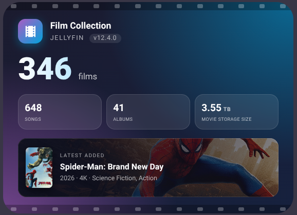

# Jellyfin Library Card

A Home Assistant Lovelace card for the [JellyHA](https://github.com/zupancicmarko/JellyHA) integration.



*Preview uses sample data and stand-in artwork.*

## Features
- Big animated film count
- Up to four configurable boxes: series, episodes, songs, albums, artists, videos, active clients or any sensor
- Jellyfin version badge
- **Now watching**: every client currently playing (or paused), with poster, user, device and progress. Hidden when nobody is watching
- **Latest added** film with backdrop art and poster
- Tap any box to open the sensor pop-up, or set your own action
- Full visual editor, no YAML needed

## Install
1. Copy `jellyfin-library-card.js` to `/config/www/`
2. Settings > Dashboards > Resources > add `/local/jellyfin-library-card.js` as a *JavaScript module*
3. Add the card: `type: custom:jellyfin-library-card`

All entities default to JellyHA's names, so no config is needed.

## Options
| Option | Default | Description |
|---|---|---|
| `entity` | `sensor.jellyha_movies` | Film count |
| `clients_entity` | `sensor.jellyha_connected_clients` | Active clients |
| `library_entity` | `sensor.jellyha_library` | Fallback: uses its movies/series/episodes attributes if a count sensor is missing |
| `latest_entity` | `sensor.jellyha_latest_movie` | Latest film |
| `version_entity` | `sensor.jellyha_jellyfin_version` | Jellyfin version |
| `title` / `subtitle` | `Film Collection` / `Jellyfin` | Header text |
| `show_extras` | `true` | Show the boxes |
| `box1_type` ... `box4_type` | `series`, `episodes`, `clients`, `none` | `none`, `series`, `episodes`, `songs`, `albums`, `artists`, `videos`, `movies`, `clients`, `custom` |
| `boxN_name` | | Custom label |
| `boxN_entity` | | Any numeric sensor; overrides the type |
| `boxN_attribute` | | Read this attribute instead of the state |
| `boxN_tap_action` | `more-info` | Tap action for the box |
| `show_latest` | `true` | Latest added section |
| `show_now_playing` | `true` | Now watching list |
| `show_paused` | `true` | Include paused sessions |
| `players` | all `media_player.jellyha_*` | Limit Now watching to these players |
| `film_tap_action`, `latest_tap_action` | `more-info` | Tap actions for the film count and latest added |

## Example: count songs and albums too
```yaml
type: custom:jellyfin-library-card
box1_type: series
box2_type: episodes
box3_type: songs
box4_type: albums
```
